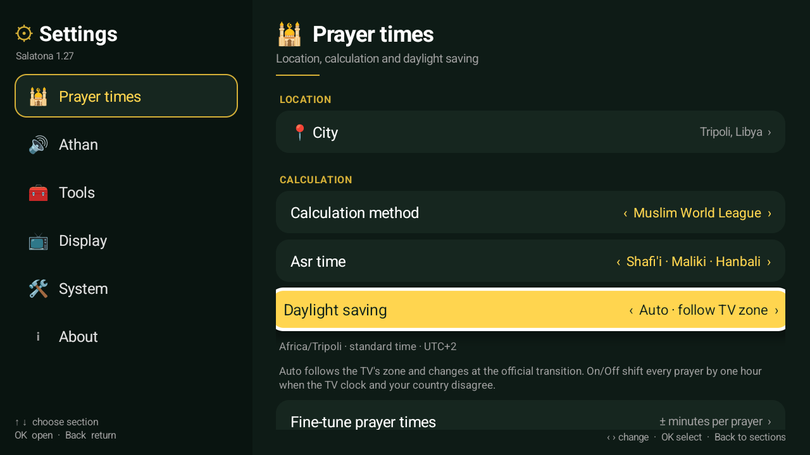
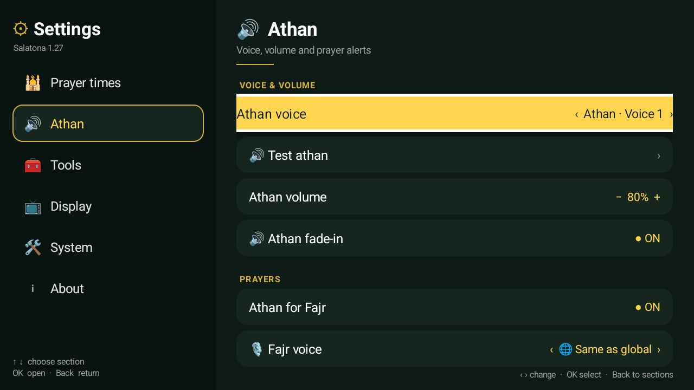
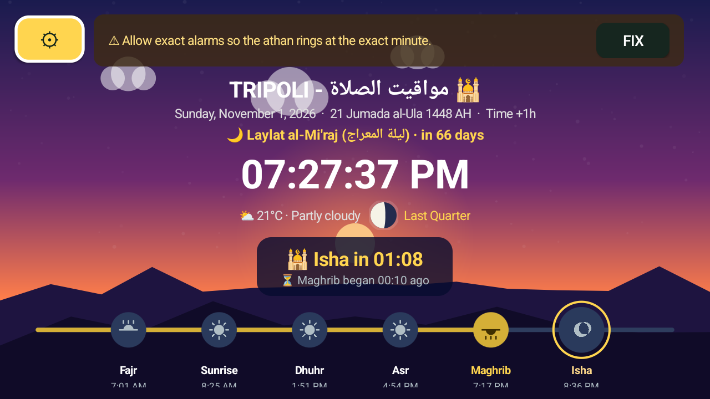
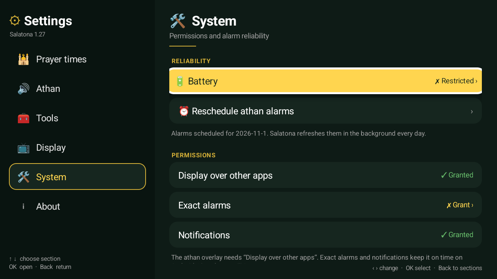
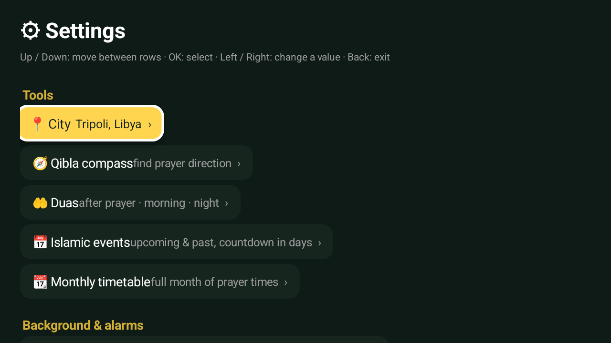

# Verification — v1.27

Date: 2026-11-01 · Build: `versionCode 28`, `versionName 1.27` · signed with
the local debug key.

## Automated checks

```sh
ANDROID_SDK_ROOT=../sdk bash test/run-dst-test.sh
# 55 checks passed, 0 failed
```

Covers winter/summer/transition days in `America/New_York`, the ±1-hour manual
modes, a half-hour zone (`Asia/Kolkata`), and the `toMillis` wall-clock
round-trip. `PrayerCalc.toLocal()` is Android-free, so the test runs on the
desktop JVM with `android.jar` only on the compile classpath.

## Device checks

Android TV API 34 emulator, 1280×720 at 213 dpi (960×540 dp — the same dp
canvas as a 1080p TV at 320 dpi), clean install of the APK. City: Tripoli;
time zone: `Africa/Tripoli` unless noted.

- **Settings, two panes.** Six sections on the start-side rail; Up/Down moves,
  OK opens, Back returns. Every content row is still one focusable and
  Left/Right update values in place.
- **Daylight saving, Auto.** With the TV zone set to `Australia/Sydney` the
  row reads `Australia/Sydney · daylight saving active · UTC+11`; with
  `Africa/Tripoli` it reads `Africa/Tripoli · standard time · UTC+2`.
- **Daylight saving, On.** Selecting *On · +1 hour* shows
  `Africa/Tripoli · shifted +1 hour · UTC+3`; the dashboard appends
  `Time +1h` and every prayer moves one hour later (Fajr 6:01 → 7:01 AM,
  Dhuhr 12:51 → 1:51 PM, Isha 7:36 → 8:36 PM).
- **Daylight saving, Off.** Shows `shifted −1 hour · UTC+1`; the dashboard
  moves every prayer one hour earlier.
- **Alarms reschedule.** `dumpsys alarm` for the next Fajr (`ATHAN_20`):
  - Auto: `origWhen=2026-11-02 06:02:00`
  - On: `origWhen=2026-11-02 07:02:00`
  - back to Auto: `origWhen=2026-11-02 06:02:00`
- **Permissions.** Overlay granted, notification row shows Granted, exact
  alarms grants from the System section, battery state reads Restricted.
- **Old layout for comparison.** v1.26 built from `a361682`, clean-installed,
  settings screenshot captured.

## Screenshots

| | |
|---|---|
|  |  |
| **Prayer times.** Rail + rows, full-width values, DST status and explanation. | **Athan.** Grouped into Voice & volume / Prayers / Alerts; scrolls under the fixed header. |
|  |  |
| **Daylight saving on.** `On · +1 hour`, status shows UTC+3. | **Dashboard.** Date line carries `Time +1h`; timeline and countdown use the shifted times. |
|  |  |
| **System.** Battery, reschedule action, permission states. | **Before (v1.26).** One long column; labels and values ran together, rows were wrap-width. |

## Not covered here

- A physical TV/remote (the emulator was driven with `adb input keyevent`).
- The notification-permission system dialog (the permission was granted with
  `pm grant` for the test); the row and request path are wired.
- Audio output (the emulator ran with `-no-audio`); the athan overlay was not
  triggered.
