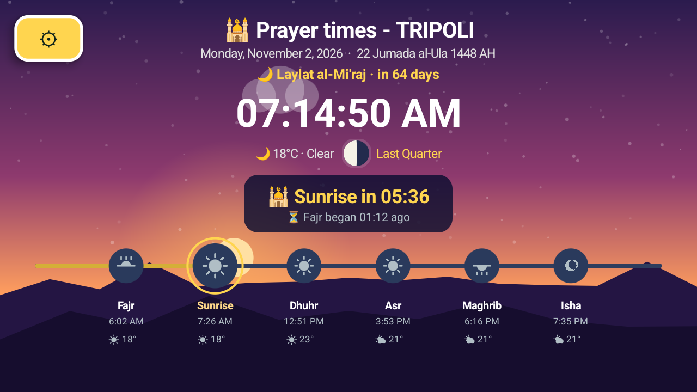
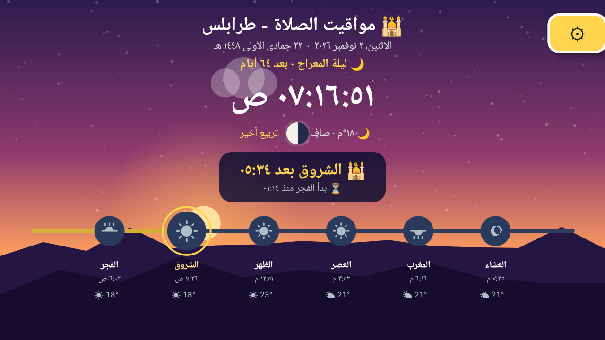
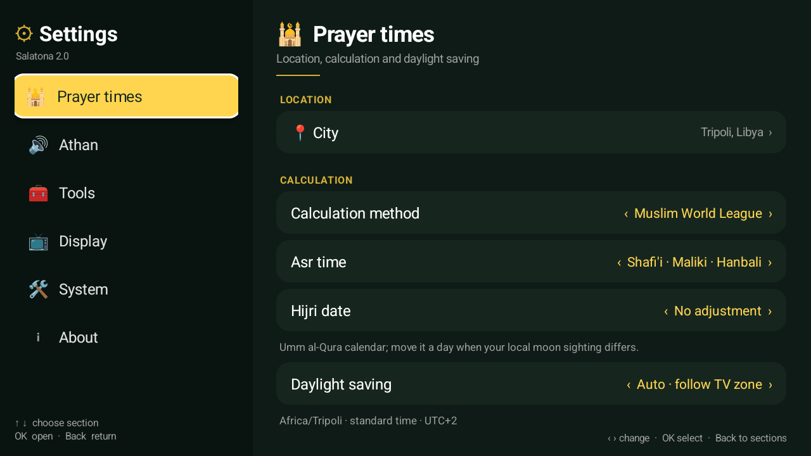
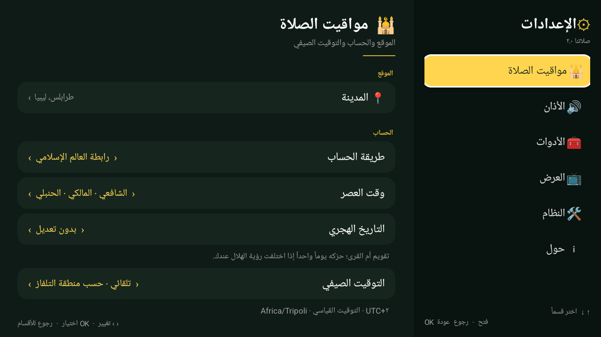
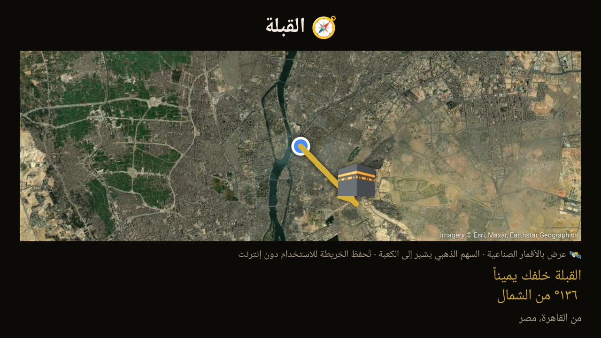
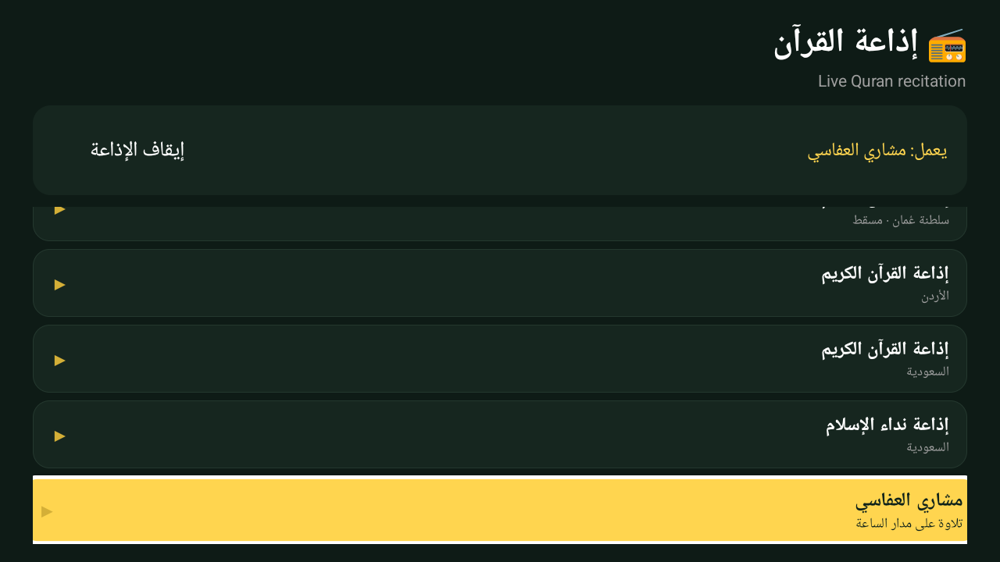
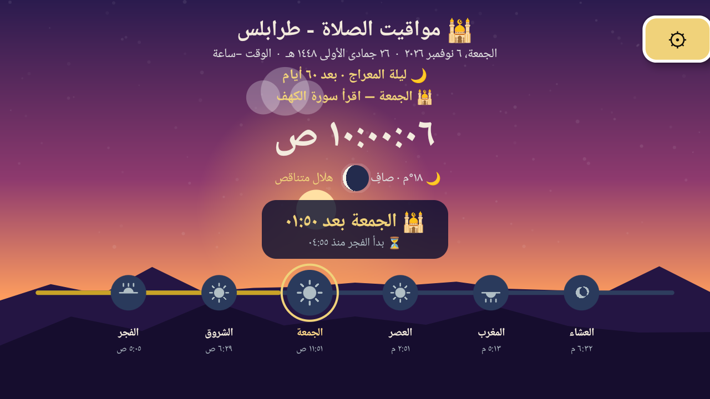
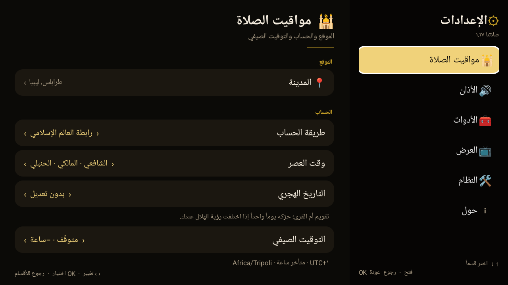

# Verification — v2.0

Date: 2026-11-02 · Build: `versionCode 29`, `versionName 2.0` · signed with
the local debug key.

## Automated checks

```sh
ANDROID_SDK_ROOT=../sdk bash test/run-dst-test.sh
# 84 checks passed, 0 failed
```

Covers the 14 calculation methods (all finite, Dhuhr near solar noon),
winter/summer/transition days in `America/New_York`, the ±1-hour DST modes,
a half-hour zone (`Asia/Kolkata`), and the `toMillis` wall-clock round-trip.
`PrayerCalc.toLocal()` is Android-free, so the suite runs on the desktop JVM
with `android.jar` only on the compile classpath.

## Device checks

Android TV API 34 emulator, 1280×720 at 213 dpi (960×540 dp), clean install of
the APK. Cities and dates below were changed during the run and reset after.

- **English UI.** Dashboard, settings rail and rows render in English; the
  screenshots show `Salatona 2.0`.
- **Arabic UI / RTL.** Settings → Display → Language → العربية recreates the
  screen with the rail on the right, Arabic labels, Arabic-Indic digits,
  Arabic weekdays/months and Hijri names. Switching back to English restores
  the LTR layout.
- **24-hour clock.** Setting the TV to 24-hour removes AM/PM from the dashboard
  clock, the timeline and the timetable (`07:10:15`, `05:02`). The Display row
  can also force 12h or 24h.
- **Per-city defaults.** Choosing Cairo from the city picker set the method to
  Egyptian Authority and left the Asr school at Shafi'i; the city row shows
  `القاهرة، مصر` / `Cairo, Egypt`.
- **Friday / Jumu'ah.** System date set to Friday 6 November 2026. The date
  line reads الجمعة, the Dhuhr timeline node and countdown say الجمعة, and the
  Surat al-Kahf card appears.
- **Qibla room mode.** Set TV faces = North, then opened Qibla: the screen
  reads `القبلة خلفك يميناً` (Qibla behind-right) and `١٣٦° من الشمال`, with
  the Cairo map and Kaaba marker.
- **Quran radio.** Opened from Tools → Quran radio. A reciter channel
  (`Mishary Alafasy`, direct MP3) played and the header showed
  `يعمل: مشاري العفاسي`; the foreground player continued across screens.
  The Cairo radiojar stream failed in this emulator (source error -1); the
  direct mp3quran reciters are the safe default.
- **Night colours.** Toggling Night colours in Display recreated the screen
  with the warm/dim palette (background, cards, gold).
- **Hijri offset.** ±2-day row added under Prayer times → Calendar, applied
  by the dashboard, timetable, events and taraweeh scheduler.
- **Daylight saving.** Still verified from the previous cycle: Auto/±1h status,
  dashboard badge and alarms rescheduling (next Fajr 06:02 Auto → 07:02 On →
  06:02 Auto).
- **Arabic announcement.** A seventh voice option (`Arabic announcement`) is
  wired to Arabic TTS with an English fallback. Audio output was not audible
  because the emulator runs with `-no-audio`.

## Screenshots

| | |
|---|---|
|  |  |
| **English dashboard.** 12-hour clock, English labels. | **Arabic dashboard.** RTL, Arabic-Indic digits, Arabic date and Hijri date. |
|  |  |
| **Settings (English).** Hijri offset row and reorganized sections. | **Settings (Arabic).** Rail on the right; no mixed English chrome. |
|  |  |
| **Qibla room mode.** “Behind-right, 136° from north.” | **Quran radio.** Arabic station list and live status. |
|  |  |
| **Friday.** Jumu'ah replaces Dhuhr; Surat al-Kahf card. | **Night colours.** Warm palette on the settings screen. |

## Known limitations

- A physical TV/remote was not used; input was `adb input keyevent`.
- Audio was disabled, so the athan, unmute, Arabic TTS and radio audio were
  verified by state/UI and code, not by listening.
- The Cairo radiojar stream failed on this emulator; some HLS stations may also
  depend on firmware codec support. The direct reciter MP3s are reliable.
- No new recorded adhan voices were added (the existing recordings are
  unlicensed); the extra voice is the Arabic TTS announcement.
- Duas keep their English translation line in Arabic mode by design; the
  Arabic text is the primary content.
